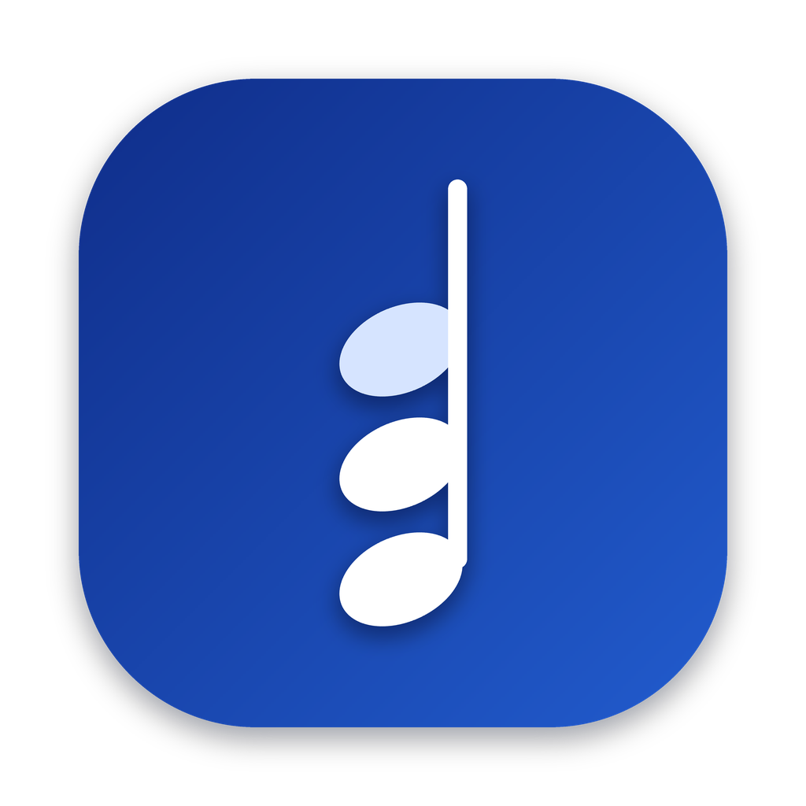
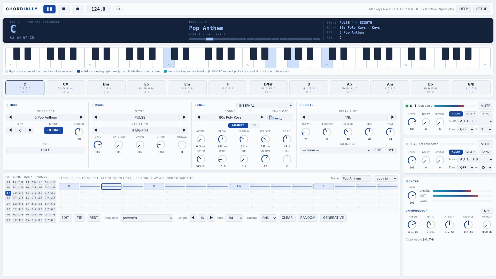
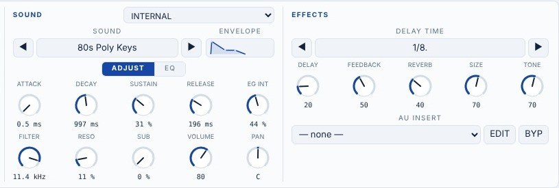
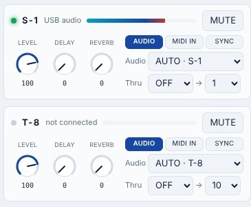

<h1 align="center">Chordially</h1>

<b>Your band in a box for the Roland S-1 and T-8.</b> Free and open source for macOS.

🎬 [Watch the 40-second promo](https://github.com/fatigued-sorcerer/chordially/raw/main/dist/Chordially-promo.mp4)

You bring the groove and the lead lines. Chordially handles the chords and the arrangement around you.

Start from a library of ready-made chord progressions, or build your own in the chord sequencer. Playback comes from the built-in synth, with simple controls you can shape on the fly. If you want a different sound, load your own plugin instruments and effects (Audio Units — the format Mac plugins install next to their VST), or stay with the included reverb and delay.

Connecting your gear is simple. Plug the S-1 and T-8 into your Mac with a USB cable. Audio and MIDI both come through that one connection and stay in sync, so your hardware and software play as one hybrid setup.

No complicated routing. No setup headaches. Just plug in, pick a progression, and play.

## Features
- **One key, one chord:** 64 chord sets, the key you press is the bass, the three notes above are voice-led so chords move smoothly.
- **Phrases:** 8 styles × 8 variations — arpeggios, pulses, rhythms, strums — with gate, swing and strum controls.
- **Chord sequencer:** 64 patterns of up to 64 steps (type the length in), step edit, real-time record, RANDOM and GENERATIVE, UNDO, RESET to the stock pattern and INIT.
- **Built-in synth:** 62 chord sounds in the style of classic 80s polysynths; ADSR, filter, resonance, sub, EQ, pan.
- **Plugins:** any Audio Unit instrument, plus one AU insert effect; built-in delay, reverb and master compressor.
- **S-1 / T-8:** USB audio mixed in, per-box AUDIO / MIDI IN / SYNC, works with aggregate devices.
- **MIDI:** in and out, clock master or follower, MIDI learn on every knob; ready for the Arturia KeyStep 37.
- Six skins and a complete built-in manual (press **?** in the app).

| Sound and effects | S-1 / T-8 |
|---|---|
|  |  |

## Download
**[⬇ Download Chordially.dmg](https://github.com/fatigued-sorcerer/chordially/raw/main/dist/Chordially.dmg)** (version 2.0.2, also on the [Releases](https://github.com/fatigued-sorcerer/chordially/releases/latest) page), open it and drag Chordially to Applications. The app is not notarized: on first launch go to System Settings → Privacy & Security and click **Open Anyway**.

Chordially isn't notarized by Apple (it's a free hobby project), so the first launch needs one extra step:
open it once, then go to **System Settings → Privacy & Security** and click **Open Anyway**.
macOS also asks for microphone access — that's needed to hear USB audio from the S-1 / T-8.

Requires macOS 13 or newer (Apple Silicon or Intel).

## Build from source
1. Install the Xcode Command Line Tools: `xcode-select --install`
2. Double-click `app/Build Chordially.command`.

It compiles everything, runs the self-test, and puts `Chordially.app` and `Chordially.dmg` in the repository folder (logs in `log/`).

## Layout
- `app/core` — the C core: clock, chords, phrases, sequencer, MIDI, effects, state (`cm.c`, `part_chord.c`, `chords.c`, `phrases.c`).
- `app/engines` — the built-in synth engines.
- `app/shell` — the Mac app: CoreAudio, CoreMIDI, USB audio in, Audio Unit hosting, window (Swift + C).
- `app/web/index.html` — the whole interface (no build step).
- `tests` — core, fuzz, preset and interface tests. `docs/MIDI-Implementation.md` — the MIDI chart.

## Support
Chordially is free. If it makes your jams better, you can support its development:
**[Sponsor on GitHub](https://github.com/sponsors/fatigued-sorcerer)** · **[☕ Buy me a coffee on Ko-fi](https://ko-fi.com/H0N52AZX84)**

## Licence
GPL-3.0-only — see [LICENSE](LICENSE). © 2026 Pavel Vild.

Chordially is an independent project, not affiliated with or endorsed by Roland Corporation or Arturia.
Roland, S-1, T-8 and J-6 are trademarks of Roland Corporation; Arturia and KeyStep are trademarks of Arturia.
They are used only to describe compatibility. See [NOTICE.md](NOTICE.md).
